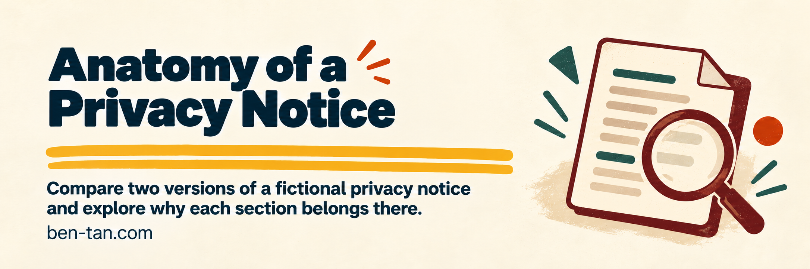

# Anatomy of a Privacy Notice

Compare two versions of a fictional privacy notice and explore why each section belongs there.

<p>
<a href="https://ben-tan.com/guides/privacy-notice/"></a>&nbsp; 
<a href="https://ko-fi.com/itsbent"><picture><source media="(prefers-reduced-motion: reduce)" srcset="docs/images/buttons/kofi-static.svg"></picture></a>&nbsp; 
</p>

[](docs/images/banner.png)

*[Open at ben-tan.com](https://ben-tan.com/guides/privacy-notice/).*

## What it does

Switch between a detailed newspaper and a plain-language grocery flyer. The two editions explain 15 topics through 58 aligned facts. Expand lessons, nested examples, and source links to examine the drafting choices.

The fictional Example Studio notice is teaching material. It is not this website's privacy policy or an adopted compliance template.

## Run locally

Use Node.js 22 or newer. No dependency installation is required. This source snapshot omits runtime images and artwork masters. `npm run verify` checks the included content and source without those images. A complete visual build requires the external files listed in `ASSET-REQUIREMENTS.json`; three square PNG requirements retain their unapproved local-candidate status.

```sh
npm run build
npm run preview
```

Open [the plain-language edition](http://127.0.0.1:8920/guides/privacy-notice/?edition=plain), or use `edition=full` for the newspaper. `PORT` selects another preview port. Links to other website pages lead to their public destinations.

## Build and check

```sh
npm run verify
# After supplying the external runtime images:
npm run build
npm run verify:build
```

`packages/privacy-notice/` contains the content, templates, and builder. `site/guides/privacy-notice/` receives the generated page; runtime artwork must be supplied separately. Shared styles, fonts, vendor scripts, and license texts are included. The external-media manifest lists the required icons and images. Source verification checks the included files, paired facts, and lesson mappings. The separate build verification checks generated HTML and local references after the external media is supplied.

## Limitations

Legal examples use the EU GDPR, with UK and US rules where labeled. Sources were checked for the teaching edition on October 20, 2026; check the underlying law and your own circumstances before relying on an example. The lesson does not supply legal advice or establish compliance.

## License and credits

Authored content and artwork retain their existing rights; no blanket reuse license is granted. Preserve the original artwork, attribution, and [third-party notices](THIRD-PARTY-NOTICES.md), including the bundled font and icon licenses.

---

Made by [Ben Tan](https://ben-tan.com). [Report a security issue](SECURITY.md).
